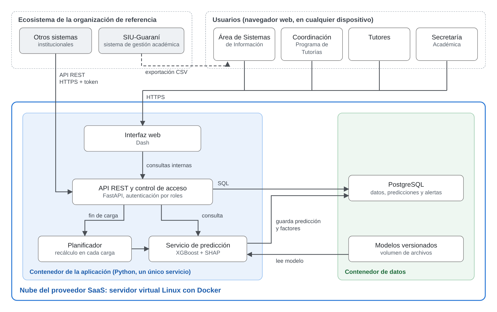

# Arquitectura

## Lo que dice el documento (Figura 9 y Herramientas de Software)

- Servidor virtual Linux del proveedor SaaS con **dos contenedores de Docker**:
  - **Aplicación (Python, un único servicio):** interfaz web en Dash, API REST con
    control de acceso en FastAPI, planificador (recálculo en cada carga) y servicio de
    predicción (XGBoost + SHAP).
  - **Datos:** PostgreSQL (datos, predicciones y alertas) y modelos versionados
    (volumen de archivos).
- Flujo: el Área de Sistemas exporta un CSV desde SIU-Guaraní y lo carga desde la
  interfaz → al terminar una carga válida, el planificador dispara el recálculo → el
  servicio de predicción lee el modelo del momento y guarda predicciones y factores →
  tutores, coordinación y Secretaría consultan las alertas desde el navegador.
- Dash se integra con FastAPI en un esquema monolítico; FastAPI se elige por su soporte
  asíncrono, para calcular sin bloquear el resto del sistema.
- **El Sprint 1 implementa** la interfaz web, el servicio de predicción, el planificador
  y la base de datos. La API para otros sistemas y la autenticación por roles son del
  diseño integral.

## Cómo se implementa en el prototipo

| Componente | Implementación | Ubicación |
|---|---|---|
| Servicio único | FastAPI como aplicación ASGI principal; Dash (Flask, WSGI) montado en `/` con `a2wsgi.WSGIMiddleware`. Las rutas de FastAPI (`/salud`, `/api/...`) se registran antes del montaje | `src/alerta_temprana/app.py` |
| Interfaz web | Dash (+ dash-bootstrap-components para el diseño de las Figuras 5 a 7) | `ui/` |
| API interna | Rutas de FastAPI bajo `/api/` que usan las funciones de `datos/`, `servicio/` y `db/` | `api/` |
| Planificador | Al terminar una carga válida se encola el recálculo en segundo plano (`BackgroundTasks` de FastAPI o un hilo), sin bloquear la interfaz | `servicio/` |
| Servicio de predicción | Carga el modelo habilitado del momento desde `modelos/`, calcula probabilidad, nivel y los 5 factores SHAP, y guarda todo con fecha y versión | `servicio/` |
| Base de datos | PostgreSQL 17, tablas del DER (`03-modelo-de-datos.md`) | contenedor `db` |
| Modelos versionados | Archivos en `modelos/<momento>/v<N>/` (modelo + metadatos JSON). Se entrenan con scripts en el entorno virtual y el contenedor los monta **de solo lectura** | `modelos/` |
| Entrenamiento | Scripts de línea de comandos, no un botón de la interfaz (HU-002 la ejecuta el Área de Sistemas) | `scripts/`, `modelo/` |

**Pendiente de confirmar** (ver `08-decisiones.md`): si los callbacks de Dash llaman a la
API interna por HTTP o directamente a las funciones de servicio. Por defecto: llaman a
las funciones de servicio, y la API expone las mismas funciones; así la «consulta
interna» de la Figura 9 no agrega una llamada de red dentro del mismo proceso.

## Contenedores y redes (`compose.yaml`)

- `db`: `postgres:17-alpine`, volumen `datos_db`, solo en la red `interna`
  (`internal: true`), sin puertos publicados, control de salud con `pg_isready`.
- `app`: imagen del `Dockerfile` (Python 3.13 slim, usuario sin privilegios), redes
  `interna` y `frontal`, puerto `127.0.0.1:8000`, control de salud contra `/salud`,
  espera a que la base esté sana.
- `compose.dev.yaml` (solo desarrollo): publica la base en `127.0.0.1:5432` para usarla
  desde el entorno virtual (notebooks, scripts, `uvicorn --reload`).

## Diferencias con el documento a corregir al final

- La tarea 1.1 del sprint backlog dice «contenedores Docker de la API, la base de datos y
  el panel» (tres), mientras que la Figura 9 muestra dos. Ver `../pendientes-documento.md`.
