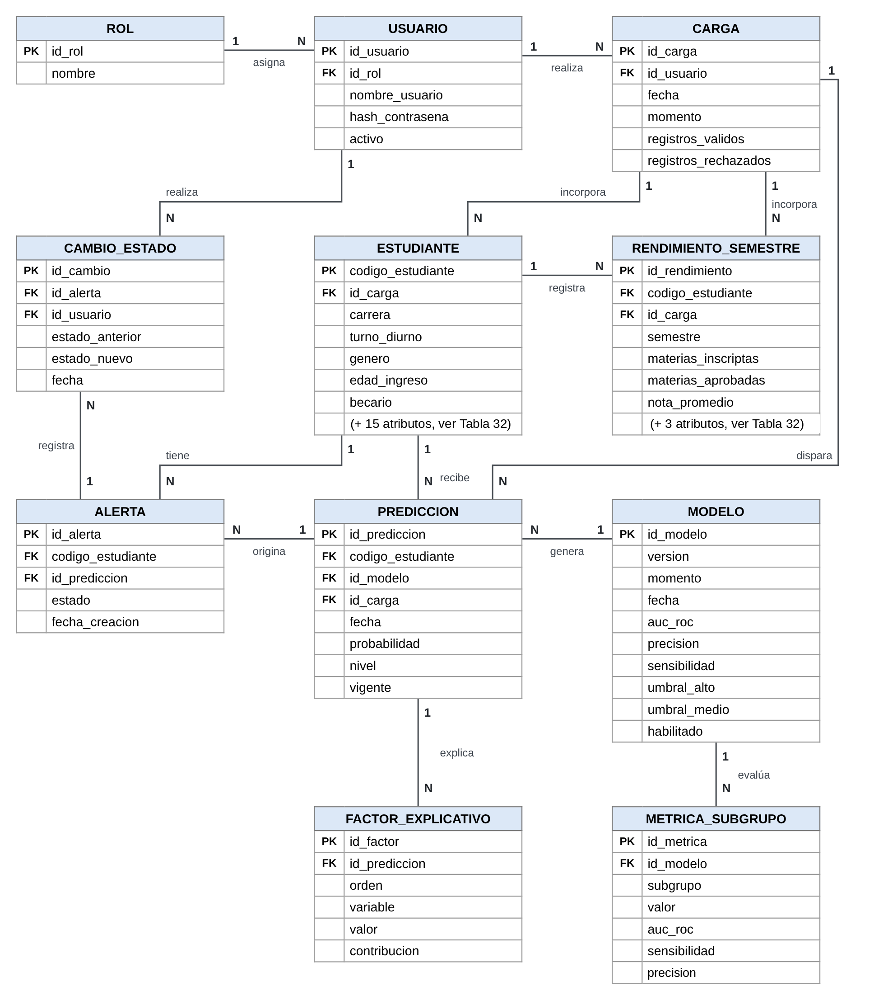

# Modelo de datos (DER del prototipo)

Las entidades y atributos son los del DER y del diccionario de datos (Tabla 32) del
documento. **Los tipos de las entidades que no están en la Tabla 32 son una propuesta**
(el documento solo dice que usan nombres descriptivos en español); si se cambian, hay que
mantener los nombres de los campos.

USUARIO y ROL existen porque el registro del seguimiento guarda quién hizo cada cambio.
En el Sprint 1 se cargan con un usuario de prueba por rol, sin inicio de sesión.

## Entidades

### ROL
| Campo | Tipo | Descripción |
|---|---|---|
| id_rol (PK) | SMALLINT | Identificador |
| nombre | VARCHAR(40) | `area_sistemas`, `coordinacion_tutorias`, `tutor`, `secretaria_academica` |

### USUARIO
| Campo | Tipo | Descripción |
|---|---|---|
| id_usuario (PK) | INTEGER | Identificador |
| id_rol (FK → ROL) | SMALLINT | Rol del usuario |
| nombre_usuario | VARCHAR(40) | Por ejemplo `sistemas01`, `coordinacion01`, `tutor01` |
| hash_contrasena | VARCHAR(255), nulo | Sin uso en el Sprint 1 (HU-009, Sprint 2) |
| activo | BOOLEAN | Usuario habilitado |

### CARGA
| Campo | Tipo | Descripción |
|---|---|---|
| id_carga (PK) | INTEGER | Identificador |
| id_usuario (FK → USUARIO) | INTEGER | Quién hizo la carga |
| fecha | TIMESTAMPTZ | Fecha y hora de la carga |
| momento | VARCHAR(12) | `inscripcion`, `cierre_1s` o `cierre_2s` |
| registros_validos | INTEGER | Registros incorporados |
| registros_rechazados | INTEGER | Registros con errores (van al informe de errores) |

### ESTUDIANTE (Tabla 32)
| Campo | Tipo | Long. | Variable original | Descripción |
|---|---|---|---|---|
| codigo_estudiante (PK) | VARCHAR | 12 | Generado | Código seudonimizado |
| id_carga (FK → CARGA) | INTEGER | 10 | – | Carga en la que se incorporó |
| estado_civil | SMALLINT | 1 | Marital status | 1 soltero, 2 casado, 3 viudo, 4 divorciado, 5 unión de hecho, 6 separado legalmente |
| nacionalidad | SMALLINT | 2 | Nacionality | Código |
| desplazado | BOOLEAN | 1 | Displaced | Vive fuera de su lugar de origen para estudiar |
| genero | BOOLEAN | 1 | Gender | 1 masculino, 0 femenino |
| edad_ingreso | SMALLINT | 2 | Age at enrollment | Años al inscribirse |
| internacional | BOOLEAN | 1 | International | Estudiante internacional |
| nivel_educ_madre | SMALLINT | 2 | Mother's qualification | Código |
| nivel_educ_padre | SMALLINT | 2 | Father's qualification | Código |
| ocupacion_madre | SMALLINT | 2 | Mother's occupation | Código |
| ocupacion_padre | SMALLINT | 2 | Father's occupation | Código |
| becario | BOOLEAN | 1 | Scholarship holder | Tiene beca |
| tasa_desempleo | NUMERIC(4,1) | 4 | Unemployment rate | % |
| tasa_inflacion | NUMERIC(3,1) | 4 | Inflation rate | % |
| variacion_pib | NUMERIC(4,2) | 5 | GDP | % |
| modalidad_ingreso | SMALLINT | 2 | Application mode | Código |
| carrera | SMALLINT | 2 | Course | Código |
| turno_diurno | BOOLEAN | 1 | Daytime/evening attendance | 1 diurno, 0 nocturno |
| titulo_previo | SMALLINT | 2 | Previous qualification | Código |
| nota_titulo_previo | NUMERIC(4,1) | 5 | Previous qualification (grade) | Escala de 0 a 200 |
| situacion_final | VARCHAR | 10 | Target | `abandono`, `cursando` o `graduado`; solo en datos históricos |

> Atención con los tipos: si el archivo de UCI usa los **códigos originales** (por ejemplo,
> carrera 9238 en lugar de 1 a 17), `carrera` y las ocupaciones no entran en una longitud
> de 2 y `SMALLINT` sigue sirviendo (hasta 32767). Se confirma al descargar el dataset
> (`data/raw/fuente.json`, campo `valores_codificados`) y se anota en
> `../pendientes-documento.md`.

### RENDIMIENTO_SEMESTRE (Tabla 32)
| Campo | Tipo | Variable original | Descripción |
|---|---|---|---|
| id_rendimiento (PK) | INTEGER | – | Identificador |
| codigo_estudiante (FK → ESTUDIANTE) | VARCHAR(12) | – | Estudiante |
| id_carga (FK → CARGA) | INTEGER | – | Carga en la que se incorporó |
| semestre | SMALLINT | 1st sem / 2nd sem | 1 o 2 |
| materias_acreditadas | SMALLINT | Curricular units (credited) | Por equivalencia |
| materias_inscriptas | SMALLINT | Curricular units (enrolled) | Inscriptas |
| evaluaciones | SMALLINT | Curricular units (evaluations) | Evaluaciones rendidas |
| materias_aprobadas | SMALLINT | Curricular units (approved) | Aprobadas |
| nota_promedio | NUMERIC(4,2) | Curricular units (grade) | Escala de 0 a 20 |
| materias_sin_evaluacion | SMALLINT | Curricular units (without evaluations) | Sin evaluaciones |

Restricción sugerida: único (`codigo_estudiante`, `semestre`).

### MODELO
| Campo | Tipo | Descripción |
|---|---|---|
| id_modelo (PK) | INTEGER | Identificador |
| version | VARCHAR(10) | Por ejemplo `1.0` (la ficha muestra «modelo v1.0») |
| momento | VARCHAR(12) | Momento para el que se entrenó |
| fecha | TIMESTAMPTZ | Fecha de entrenamiento |
| auc_roc | NUMERIC(5,4) | Sobre el conjunto de prueba |
| precision | NUMERIC(5,4) | Sobre prueba, tomando como alerta los niveles alto y medio |
| sensibilidad | NUMERIC(5,4) | Ídem |
| umbral_alto | NUMERIC(5,4) | Probabilidad desde la que el nivel es alto |
| umbral_medio | NUMERIC(5,4) | Probabilidad desde la que el nivel es medio |
| habilitado | BOOLEAN | Se usa para predecir (HU-002, criterio 3) |

Restricción sugerida: un solo modelo habilitado por momento.

### METRICA_SUBGRUPO
| Campo | Tipo | Descripción |
|---|---|---|
| id_metrica (PK) | INTEGER | Identificador |
| id_modelo (FK → MODELO) | INTEGER | Modelo evaluado (solo `cierre_1s`) |
| subgrupo | VARCHAR(20) | `genero`, `edad_ingreso`, `becario` |
| valor | VARCHAR(20) | Por ejemplo `femenino`, `21 a 25`, `sí` |
| auc_roc | NUMERIC(5,4) | |
| sensibilidad | NUMERIC(5,4) | |
| precision | NUMERIC(5,4) | |

### PREDICCION
| Campo | Tipo | Descripción |
|---|---|---|
| id_prediccion (PK) | INTEGER | Identificador |
| codigo_estudiante (FK → ESTUDIANTE) | VARCHAR(12) | Estudiante |
| id_modelo (FK → MODELO) | INTEGER | Modelo usado |
| id_carga (FK → CARGA) | INTEGER | Carga que disparó el cálculo |
| fecha | TIMESTAMPTZ | Fecha del cálculo |
| probabilidad | NUMERIC(5,4) | Probabilidad de abandono |
| nivel | VARCHAR(5) | `alto`, `medio` o `bajo` |
| vigente | BOOLEAN | La última de cada estudiante; las anteriores quedan como historial (HU-003, criterio 3) |

### FACTOR_EXPLICATIVO
| Campo | Tipo | Descripción |
|---|---|---|
| id_factor (PK) | INTEGER | Identificador |
| id_prediccion (FK → PREDICCION) | INTEGER | Predicción explicada |
| orden | SMALLINT | 1 a 5, de mayor a menor peso |
| variable | VARCHAR(40) | Nombre en la plataforma (por ejemplo `materias_aprobadas_s1`) |
| valor | VARCHAR(40) | Valor del estudiante, como texto |
| contribucion | NUMERIC(8,4) | Valor SHAP (positivo = aumenta el riesgo) |

### ALERTA
| Campo | Tipo | Descripción |
|---|---|---|
| id_alerta (PK) | INTEGER | Identificador |
| codigo_estudiante (FK → ESTUDIANTE) | VARCHAR(12) | Estudiante |
| id_prediccion (FK → PREDICCION) | INTEGER | Predicción que la originó o la vigente (ver decisiones) |
| estado | VARCHAR(20) | `pendiente`, `contactado`, `en_acompanamiento` |
| fecha_creacion | TIMESTAMPTZ | Fecha de creación |

### CAMBIO_ESTADO
| Campo | Tipo | Descripción |
|---|---|---|
| id_cambio (PK) | INTEGER | Identificador |
| id_alerta (FK → ALERTA) | INTEGER | Alerta |
| id_usuario (FK → USUARIO) | INTEGER | Quién registró el cambio |
| estado_anterior | VARCHAR(20) | |
| estado_nuevo | VARCHAR(20) | |
| fecha | TIMESTAMPTZ | Fecha y hora del cambio |

## Relaciones (cardinalidades del DER)

| Relación | Cardinalidad |
|---|---|
| ROL asigna USUARIO | 1:N |
| USUARIO realiza CARGA | 1:N |
| USUARIO realiza CAMBIO_ESTADO | 1:N |
| CARGA incorpora ESTUDIANTE | 1:N |
| CARGA incorpora RENDIMIENTO_SEMESTRE | 1:N |
| CARGA dispara PREDICCION | 1:N |
| ESTUDIANTE registra RENDIMIENTO_SEMESTRE | 1:N |
| ESTUDIANTE recibe PREDICCION | 1:N |
| ESTUDIANTE tiene ALERTA | 1:N |
| MODELO genera PREDICCION | 1:N |
| MODELO evalúa METRICA_SUBGRUPO | 1:N |
| PREDICCION explica FACTOR_EXPLICATIVO | 1:N |
| PREDICCION origina ALERTA | 1:N |
| ALERTA registra CAMBIO_ESTADO | 1:N |

## Datos iniciales

- Roles: los cuatro de la tabla ROL.
- Usuarios de prueba: uno por rol (`sistemas01`, `coordinacion01`, `tutor01`,
  `secretaria01`), sin contraseña.
- Modelos: se registran en MODELO y METRICA_SUBGRUPO a partir de los metadatos que deja
  el entrenamiento en `modelos/`.
