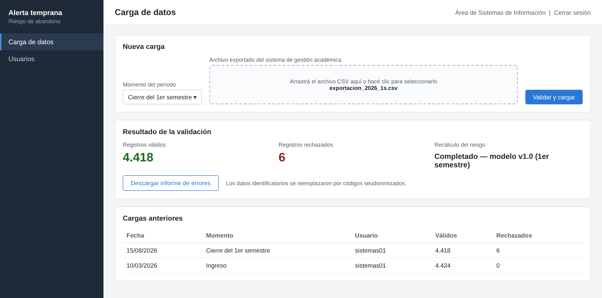
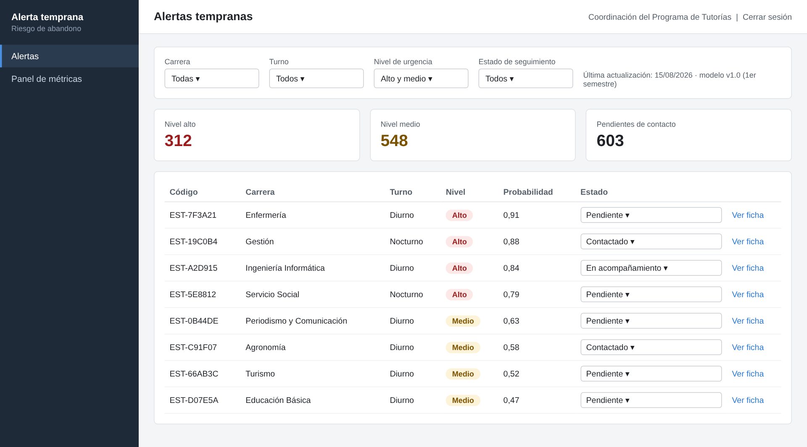
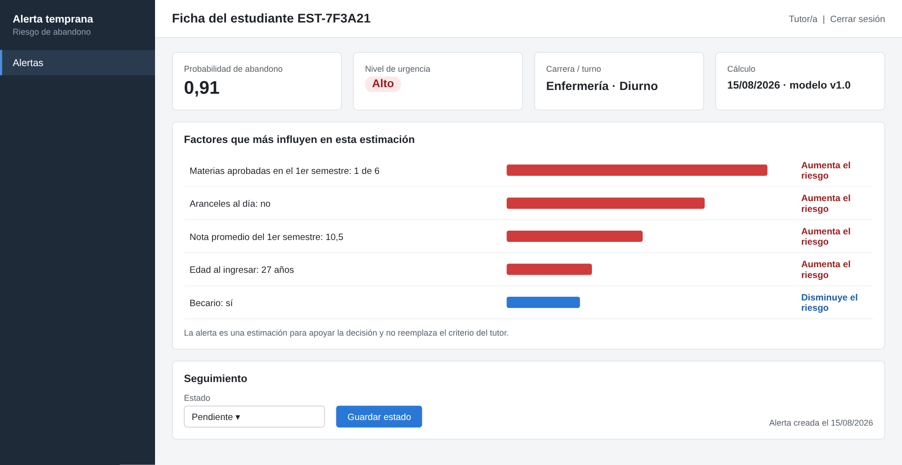
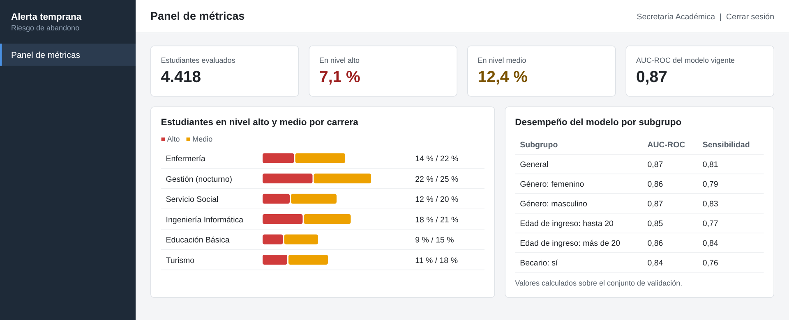

# Pantallas (Dash)

Los prototipos son las Figuras 5 a 8 del documento. Los datos que muestran son
ilustrativos. En el Sprint 1 se implementan **carga, listado y ficha**; el panel de
métricas (Figura 8, HU-008) es del diseño integral.

Elementos comunes: menú lateral oscuro con «Alerta temprana / Riesgo de abandono», título
de la pantalla arriba a la izquierda, y arriba a la derecha el rol del usuario. Como no
hay inicio de sesión en el Sprint 1, en lugar de «Cerrar sesión» va un **selector del
usuario de prueba** (Área de Sistemas, Coordinación, Tutor/a) que define el menú y el
usuario que queda registrado en cargas y cambios de estado. Formato argentino: coma
decimal y fechas dd/mm/aaaa.

## Carga de datos (Figura 5): HU-001 y HU-003

- Usuario: Área de Sistemas de Información.
- Selector de **momento de predicción** (Inscripción, Cierre del 1.er semestre, Cierre del
  2.º semestre), zona para arrastrar el CSV y botón «Validar y cargar».
- Resultado: registros válidos, registros rechazados, estado del recálculo («Completado:
  modelo v1.0 (1.er semestre)» o el motivo si no hay modelo habilitado, HU-003 criterio 5),
  botón «Descargar informe de errores» y la leyenda «Los datos identificatorios se
  reemplazaron por códigos seudonimizados».
- Tabla «Cargas anteriores»: fecha, momento, usuario, válidos, rechazados.
- Si falta una columna obligatoria, se rechaza la carga completa y se indican las columnas
  con problemas (HU-001, criterio 2).

## Listado de alertas tempranas (Figura 6): HU-005 y HU-007

- Usuarios: Coordinación del Programa de Tutorías y tutores.
- Filtros: carrera, turno, nivel de urgencia y estado de seguimiento, sin valor por
  defecto: al entrar se ven todas las alertas, incluidas las de estudiantes cuyo riesgo
  bajó a nivel bajo. A la derecha: «Última actualización: dd/mm/aaaa · modelo vX (momento)»
  (HU-003, criterio 4).
- Tarjetas: cantidad en nivel alto, en nivel medio y pendientes de contacto, sobre las
  mismas alertas que muestra la tabla (respetan el filtro activo).
- Tabla: código, carrera (nombre, no código), turno, nivel (etiqueta con color **y**
  texto), probabilidad (0,91), estado (desplegable editable) y «Ver ficha».
- Orden: nivel alto, medio y bajo y, dentro de cada nivel, probabilidad de mayor a menor.
- Sin datos identificatorios.

## Ficha del estudiante (Figura 7): HU-006 y HU-007

- Usuario: tutor/a (también Coordinación).
- Tarjetas: probabilidad de abandono, nivel de urgencia, carrera y turno, y cálculo
  (fecha · modelo vX).
- Sección **«Factores que más pesan en esta estimación»**: los cinco factores con nombre y
  valor comprensibles («Materias aprobadas en el 1.er semestre: 1 de 6»), una barra
  proporcional al peso y el texto «Aumenta el riesgo» (rojo) o «Disminuye el riesgo»
  (azul).
- Aviso debajo de los factores (HU-006, criterio 4): la alerta es una estimación para
  apoyar la decisión y no reemplaza el criterio del tutor; los factores muestran cuánto
  pesa cada variable en la estimación, no las causas del abandono.
- Sección «Seguimiento»: desplegable de estado, botón «Guardar estado» y «Alerta creada el
  dd/mm/aaaa».
- De esta pantalla salen las **capturas de los seis casos** del cuestionario.

**Diferencias del prototipo dibujado que el código NO debe copiar** (ver
`../pendientes-documento.md`): el título dice «Factores que más influyen» (usar «más
pesan»), aparece «Aranceles al día» (variable excluida) y el aviso no menciona que los
factores no son causas.

## Panel de métricas (Figura 8): no se implementa

Solo como referencia del diseño integral (HU-008).
