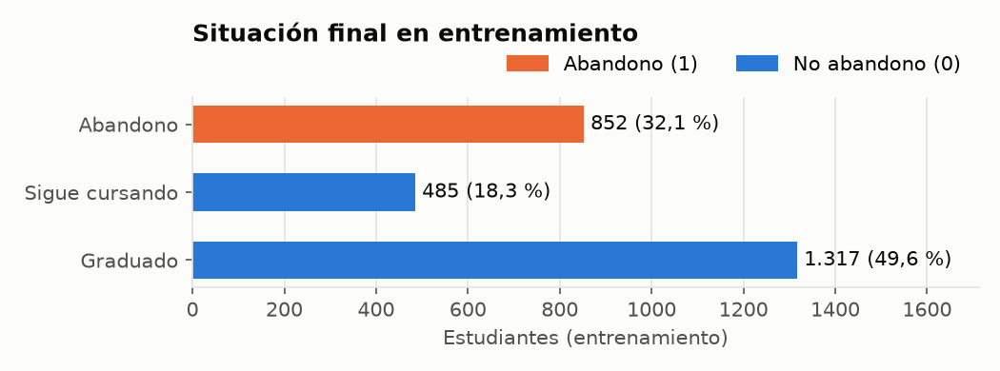
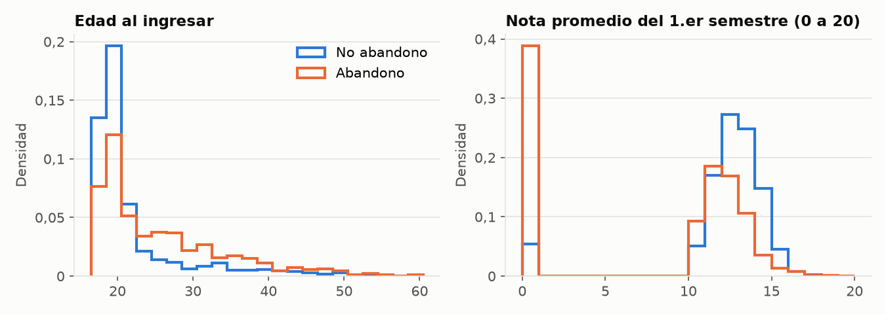
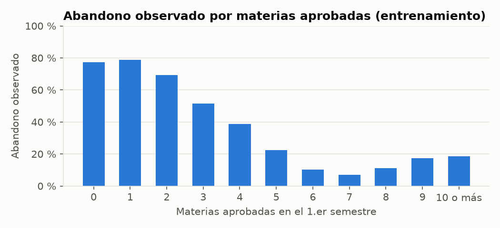
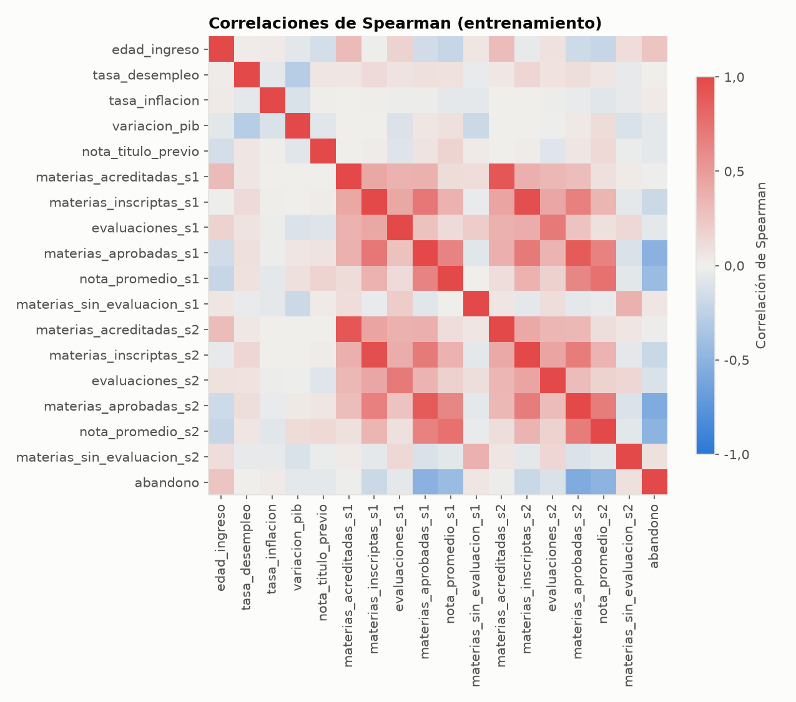

# Informe exploratorio de los datos

Generado por `scripts/explorar_datos.py` el 04/11/2026 00:42 (tarea 2.1; CRISP-DM, fase 2).

**Qué datos se miran.** Todo lo que relaciona una variable con el abandono se calcula solo con
el conjunto de **entrenamiento** (2.654 estudiantes de la partición fija 60/20/20).
Los controles de calidad que no usan la situación final (faltantes, rangos) se hacen sobre el
archivo completo (4.424 registros) sin la variable objetivo. El conjunto de prueba
no se usa en este informe.

## 1. Archivo y controles de calidad

- Fuente: Realinho et al. (2021), UCI, archivo `data/raw/data.csv`: 4.424 registros
  y 37 columnas (36 predictoras y la situación final).
- Valores faltantes en las 31 variables del modelo: **0**.
- Los códigos de las variables categóricas son los **originales de UCI** (carrera de 33 a 9991,
  ocupaciones de 0 a 195), no los correlativos del anexo del artículo (decisión P10). La
  correspondencia está en `docs/datos/anexo-codigos-realinho-2022.md`.

Rango de las variables numéricas (archivo completo):

| Variable | Mínimo | Máximo | Valores distintos |
|---|---|---|---|
| `edad_ingreso` | 17,00 | 70,00 | 46 |
| `tasa_desempleo` | 7,60 | 16,20 | 10 |
| `tasa_inflacion` | -0,80 | 3,70 | 9 |
| `variacion_pib` | -4,06 | 3,51 | 10 |
| `nota_titulo_previo` | 95,00 | 190,00 | 101 |
| `materias_acreditadas_s1` | 0,00 | 20,00 | 21 |
| `materias_inscriptas_s1` | 0,00 | 26,00 | 23 |
| `evaluaciones_s1` | 0,00 | 45,00 | 35 |
| `materias_aprobadas_s1` | 0,00 | 26,00 | 23 |
| `nota_promedio_s1` | 0,00 | 18,88 | 805 |
| `materias_sin_evaluacion_s1` | 0,00 | 12,00 | 11 |
| `materias_acreditadas_s2` | 0,00 | 19,00 | 19 |
| `materias_inscriptas_s2` | 0,00 | 23,00 | 22 |
| `evaluaciones_s2` | 0,00 | 33,00 | 30 |
| `materias_aprobadas_s2` | 0,00 | 20,00 | 20 |
| `nota_promedio_s2` | 0,00 | 18,57 | 786 |
| `materias_sin_evaluacion_s2` | 0,00 | 12,00 | 10 |

## 2. Variable objetivo y desbalance de clases

Archivo completo (distribución publicada, Realinho et al., 2022, p. 7): graduado 2.209 (49,9 %),
abandono 1.421 (32,1 %) y sigue cursando 794 (17,9 %).

En entrenamiento:

| Situación final | Valor binario | Casos | Proporción |
|---|---|---|---|
| Abandono | 1 | 852 | 32,1 % |
| Sigue cursando | 0 | 485 | 18,3 % |
| Graduado | 0 | 1.317 | 49,6 % |

La clase positiva (abandono) es el 32,1 % de entrenamiento:
hay 2,115 no abandonos por cada abandono. Ese cociente es el `scale_pos_weight` de
XGBoost; la regresión logística usa `class_weight="balanced"`. No se generan casos sintéticos.
«Sigue cursando» se agrupa con «graduado» como no abandono; por eso la evaluación final informa
también el AUC-ROC sin quienes siguen cursando.

## 3. Variables por momento de predicción y exclusiones

| Momento | Variables | Agrega |
|---|---|---|
| Inscripción | 19 | demográficas, socioeconómicas, macroeconómicas y académicas de la inscripción |
| Cierre del 1.er semestre | 25 | las seis de rendimiento del 1.er semestre (`_s1`) |
| Cierre del 2.º semestre | 31 | las seis de rendimiento del 2.º semestre (`_s2`) |

Variables excluidas (se descartan en la carga y no entran a ningún modelo):

| Variable | Motivo |
|---|---|
| `necesidades_especiales` | Dato sensible: puede revelar información de salud (Ley 25.326, arts. 2 y 7). |
| `deudor` | Sin equivalente: el grado es gratuito (Ley 24.521, art. 2 bis). |
| `aranceles_al_dia` | Sin equivalente: el grado es gratuito (Ley 24.521, art. 2 bis). |
| `orden_postulacion` | Sin equivalente: el ingreso es libre e irrestricto (Ley 24.521, art. 7). |
| `nota_admision` | Sin equivalente: el ingreso es libre e irrestricto (Ley 24.521, art. 7). |

## 4. Variables numéricas (entrenamiento)

| Variable | Media | Desvío | Mediana | Media en abandono | Media en no abandono |
|---|---|---|---|---|---|
| `edad_ingreso` | 23,17 | 7,35 | 20,00 | 25,72 | 21,97 |
| `tasa_desempleo` | 11,62 | 2,66 | 11,10 | 11,63 | 11,61 |
| `tasa_inflacion` | 1,22 | 1,39 | 1,40 | 1,28 | 1,19 |
| `variacion_pib` | 0,00 | 2,25 | 0,32 | -0,15 | 0,07 |
| `nota_titulo_previo` | 132,59 | 13,17 | 133,00 | 131,52 | 133,09 |
| `materias_acreditadas_s1` | 0,73 | 2,36 | 0,00 | 0,64 | 0,77 |
| `materias_inscriptas_s1` | 6,28 | 2,49 | 6,00 | 5,85 | 6,48 |
| `evaluaciones_s1` | 8,26 | 4,20 | 8,00 | 7,72 | 8,51 |
| `materias_aprobadas_s1` | 4,75 | 3,08 | 5,00 | 2,66 | 5,74 |
| `nota_promedio_s1` | 10,68 | 4,84 | 12,33 | 7,45 | 12,21 |
| `materias_sin_evaluacion_s1` | 0,14 | 0,73 | 0,00 | 0,19 | 0,12 |
| `materias_acreditadas_s2` | 0,56 | 1,96 | 0,00 | 0,49 | 0,60 |
| `materias_inscriptas_s2` | 6,25 | 2,22 | 6,00 | 5,81 | 6,45 |
| `evaluaciones_s2` | 8,06 | 3,94 | 8,00 | 7,18 | 8,47 |
| `materias_aprobadas_s2` | 4,48 | 3,02 | 5,00 | 2,07 | 5,63 |
| `nota_promedio_s2` | 10,27 | 5,20 | 12,25 | 6,09 | 12,24 |
| `materias_sin_evaluacion_s2` | 0,16 | 0,82 | 0,00 | 0,28 | 0,11 |

## 5. Variables categóricas (entrenamiento)

Se codifican con one-hot ajustado solo con entrenamiento. Categorías con menos de 10
casos:

| Variable | Categorías | Con < 10 casos | Estudiantes en ellas | Más frecuente |
|---|---|---|---|---|
| `estado_civil` | 6 | 2 | 7 | soltero/a (88,6 %) |
| `nacionalidad` | 17 | 15 | 40 | portuguesa (97,9 %) |
| `nivel_educ_madre` | 25 | 15 | 45 | secundario completo (12.º año) (25,2 %) |
| `nivel_educ_padre` | 31 | 20 | 46 | básica, 1.er ciclo (4.º/5.º año) (26,9 %) |
| `ocupacion_madre` | 30 | 17 | 42 | ocupaciones elementales (35,1 %) |
| `ocupacion_padre` | 40 | 27 | 55 | ocupaciones elementales (22,8 %) |
| `modalidad_ingreso` | 17 | 4 | 8 | 1.ª fase, contingente general (39,6 %) |
| `carrera` | 17 | 1 | 4 | Enfermería (17,5 %) |
| `titulo_previo` | 16 | 8 | 27 | secundario completo (84,1 %) |

En total hay 109 categorías con menos de 10 casos, que reúnen a 274 estudiantes (10,3 % de
entrenamiento). **Decisión:** no se agrupan ni se descartan. Cada una genera una columna one-hot
con pocos casos, que la regresión logística regulariza y que XGBoost casi no usa para dividir;
una categoría que no aparece en entrenamiento queda en cero (`handle_unknown="ignore"`), así que
no rompe la predicción de estudiantes nuevos. Agrupar requeriría criterios por variable que el
documento no fija.

## 6. Variables binarias y edad de ingreso (entrenamiento)

| Variable | Valor | Casos | Abandono observado |
|---|---|---|---|
| Vive fuera de su lugar de origen para estudiar | no | 1.211 | 37,7 % |
| Vive fuera de su lugar de origen para estudiar | sí | 1.443 | 27,4 % |
| Género | femenino | 1.717 | 24,9 % |
| Género | masculino | 937 | 45,3 % |
| Estudiante internacional | no | 2.597 | 32,1 % |
| Estudiante internacional | sí | 57 | 31,6 % |
| Becario | no | 2.004 | 38,6 % |
| Becario | sí | 650 | 12,0 % |
| Turno | nocturno | 301 | 44,5 % |
| Turno | diurno | 2.353 | 30,5 % |
| Edad al ingresar | hasta 20 | 1.529 | 21,9 % |
| Edad al ingresar | 21 a 25 | 504 | 35,7 % |
| Edad al ingresar | más de 25 | 621 | 54,3 % |

Género, edad y condición de becario son además los subgrupos de la evaluación de sesgos
(evaluación final, solo con el modelo del cierre del 1.er semestre).

## 7. Rendimiento del 1.er semestre (entrenamiento)

| Materias aprobadas (1.er semestre) | Casos | Abandonos | Abandono observado |
|---|---|---|---|
| 0 | 428 | 331 | 77,3 % |
| 1 | 66 | 52 | 78,8 % |
| 2 | 88 | 61 | 69,3 % |
| 3 | 169 | 87 | 51,5 % |
| 4 | 247 | 96 | 38,9 % |
| 5 | 422 | 95 | 22,5 % |
| 6 | 735 | 75 | 10,2 % |
| 7 | 284 | 20 | 7,0 % |
| 8 | 63 | 7 | 11,1 % |
| 9 | 29 | 5 | 17,2 % |
| 10 o más | 123 | 23 | 18,7 % |

**Estudiantes con 0 materias inscriptas en el 1.er semestre:** 180 en el archivo
completo y 108 en entrenamiento (abandono 42, sigue cursando 19, graduado 47).
En el archivo completo, 180 de los 180 tienen en cero **las doce** variables
de rendimiento (1.er y 2.º semestre) y 180 pertenecen a una sola carrera, Diseño de Animación y Multimedia
(código 171), que tiene 215 estudiantes en total (83,7 % de ellos sin datos de rendimiento),
repartidos en 10 de los 10 años de ingreso. Con graduados entre ellos, no es un abandono
temprano: lo más probable es que **falte el registro de rendimiento de esa carrera** en la
fuente, y que el cero signifique «sin dato» y no «no aprobó nada».

**Decisión:** se mantienen sin cambios. Las listas de variables y el modelo de `cierre_1s` (v1.0,
congelado para el cuestionario) ya se construyeron así, y el preprocesamiento no inventa valores.
El modelo puede aprender la combinación «esa carrera con todo en cero», por lo que sus
estimaciones para esa carrera en los cierres de semestre son menos confiables. Queda como
limitación para el documento. En la ficha se muestran como «sin materias inscriptas» (tarea 6.2).

## 8. Correlaciones (entrenamiento)

Correlación de Spearman (no supone relación lineal y tolera valores extremos).

Variables numéricas con mayor correlación con el abandono (en valor absoluto):

| Variable | Correlación con el abandono |
|---|---|
| `materias_aprobadas_s2` | -0,564 |
| `materias_aprobadas_s1` | -0,510 |
| `nota_promedio_s2` | -0,496 |
| `nota_promedio_s1` | -0,425 |
| `edad_ingreso` | 0,256 |
| `materias_inscriptas_s2` | -0,191 |
| `materias_inscriptas_s1` | -0,184 |
| `evaluaciones_s2` | -0,116 |
| `materias_sin_evaluacion_s2` | 0,089 |
| `nota_titulo_previo` | -0,062 |

Pares de variables con |correlación| ≥ 0,8 (3):

| Variable | Variable | Correlación |
|---|---|---|
| `materias_inscriptas_s1` | `materias_inscriptas_s2` | 0,958 |
| `materias_acreditadas_s1` | `materias_acreditadas_s2` | 0,911 |
| `materias_aprobadas_s1` | `materias_aprobadas_s2` | 0,886 |

Los pares muy correlacionados son la misma variable de rendimiento en el 1.er y en el 2.º
semestre. Solo conviven en el modelo del cierre del 2.º semestre. **Decisión:** se mantienen
todas, porque las listas de cada momento las fija
el documento y el objetivo es estimar el riesgo, no interpretar coeficientes. La correlación sí
importa al leer las explicaciones: dos variables muy correlacionadas se reparten el peso en SHAP.

## 9. Variables macroeconómicas

Toman 10 combinaciones distintas, una por año de ingreso. En entrenamiento:

| Desempleo | Inflación | Variación del PIB | Casos | Abandono observado |
|---|---|---|---|---|
| 7,6 | 2,6 | 0,32 | 339 | 35,1 % |
| 8,9 | 1,4 | 3,51 | 207 | 29,0 % |
| 9,4 | -0,8 | -3,12 | 309 | 33,3 % |
| 10,8 | 1,4 | 1,74 | 305 | 38,0 % |
| 11,1 | 0,6 | 2,02 | 254 | 28,0 % |
| 12,4 | 0,5 | 1,79 | 276 | 24,3 % |
| 12,7 | 3,7 | -1,70 | 254 | 29,5 % |
| 13,9 | -0,3 | 0,79 | 253 | 27,7 % |
| 15,5 | 2,8 | -4,06 | 240 | 38,8 % |
| 16,2 | 0,3 | -0,92 | 217 | 35,9 % |

Funcionan como un indicador del año de ingreso. **Decisión (P9, confirmada el 03/11):** se
mantienen, porque el documento las incluye en la lista de 19 variables de inscripción y la
plataforma las puede completar con los indicadores del año. Limitación: con solo diez años, el
modelo puede asociar un año puntual con más abandono sin que el indicador económico sea la razón.

## 10. Conclusiones para la preparación

- Variable objetivo binaria: abandono = 1; graduado o sigue cursando = 0.
- Desbalance moderado (32,1 % de abandono): pesos de clase,
  sin casos sintéticos.
- Sin valores faltantes: no hace falta imputar.
- Categóricas con one-hot (`handle_unknown="ignore"`), numéricas estandarizadas y binarias sin
  cambios, todo ajustado solo con entrenamiento dentro del `Pipeline`.
- Se mantienen las 31 variables del documento (19, 25 y 31 por momento) y las cinco exclusiones.
- Las variables de rendimiento del semestre son las que más se relacionan con el abandono, lo que
  anticipa que el modelo de inscripción va a rendir bastante menos que los de cierre de semestre.
